# Registro de compatibilidad — Lode Runner: The Legend Returns (Big Box)

**Ficha:** #000250 · Edición española Big Box en CD-ROM.  
**Estado:** instalación completada. Arranque desde el BIN/CUE confirmado por el responsable con DAEMON Tools Lite 12.6 en `D:` y otvdm 0.9.0. Primer nivel jugable con teclado, música de fondo y efectos confirmados por el responsable.

## 1. Copia de trabajo

BIN y CUE en `C:\Users\Miguel\git\ISOs\test`, verificados en PowerShell mediante SHA-256 contra el [registro de preservación](../registros_preservacion/lode-runner-the-legend-returns-bigbox.md). Ambos hashes coinciden con los del original.

## 2. Inspección en IsoBuster

La captura acredita que IsoBuster abrió `LODE_RUNNER_CD.CUE` y permitió navegar por **Sesión 1 → Pista 01 → ISO 9660 (`LODE_RUNNER_CD`)**. El recorte muestra las pistas 01 a 03. El recuento de 33 pistas procede del CUE y del log de preservación. La segunda captura muestra **IsoBuster 5.8** en la barra de título.

En la raíz figuran los directorios `LODERUNN` y `WING`, y los archivos `INSTALL.DAT`, `INSTALL.EXE`, `JOYSTICK.TXT` y `LODERUNN.TXT`. El nombre `INSTALL.EXE` identifica un candidato a instalador. Quedan por confirmar sus requisitos y el procedimiento de instalación documentado en el CD.

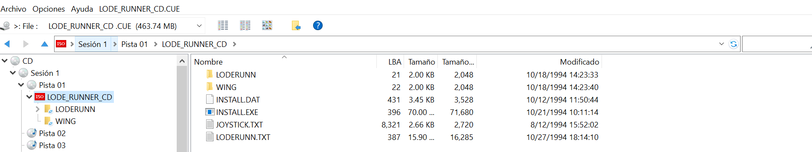

[Evidencia original de la sesión](https://chatgpt.com/library?file_id=libfile_a7bbc7e05d7881918fee7e68911faba7&account_id=personal)

## 3. Instrucciones del CD

El archivo `LODERUNN.TXT`, extraído de la pista de datos, identifica la edición descrita como **Lode Runner for Windows, CD Version 1.0**. Para la música documenta el controlador MCI CD Audio de Windows y para los gráficos describe la biblioteca WinG incluida en el CD. Las menciones a DOS se refieren, entre otras cosas, a comprobar desde el símbolo del sistema la memoria disponible antes de iniciar Windows. El texto acredita una vía Windows. La existencia de un ejecutable DOS autónomo queda pendiente de comprobar.

[LODERUNN.TXT, evidencia extraída del CD](https://chatgpt.com/library?file_id=libfile_18aa4b7bf4348191ad7e352845e3e675&account_id=personal)

## 4. Contenido de `LODERUNN`

En el primer nivel aparecen únicamente las subcarpetas `DATA`, `FILES`, `JOYSTICK` y `PUZZLES`. El interior de estas carpetas está pendiente de inventariar.

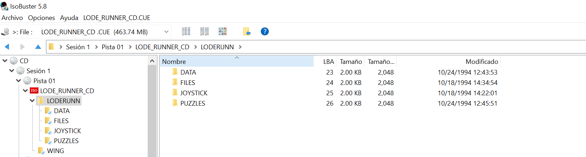

[Evidencia original de la sesión](https://chatgpt.com/library?file_id=libfile_ade4c55d63648191a0fba6ed5e1fbcbd&account_id=personal)

## 5. Formato de `INSTALL.EXE`

- Tamaño: 71.680 bytes. SHA-256: `93157e2bc64f2fc617b1f10bf82e3edd3531d69a0e5c9349eee96507e0130a1c`.
- Firma inicial `MZ`. El campo de desplazamiento en `0x3C` apunta a `0x250`, donde comienza la cabecera `NE`. El campo de sistema objetivo de la cabecera es `0x02` (Windows). Identificado como ejecutable gráfico de Windows de 16 bits para Windows 3.0 en modo protegido.
- Inspección estática de la cabecera. Instalación y ejecución pendientes de prueba.

## 6. Prueba de montaje con WinCDEmu 4.1

Al intentar montar `LODE_RUNNER_CD.CUE` de la copia de trabajo, WinCDEmu mostró `Unknown or corrupt image file!`. En este intento no se obtuvo una unidad virtual utilizable. Los SHA-256 de la copia coinciden con los de la adquisición y la pista de datos se pudo inspeccionar con IsoBuster 5.8. La causa del rechazo de WinCDEmu queda sin determinar.

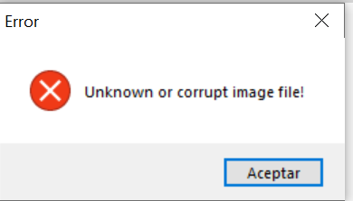

[Evidencia original de la sesión](https://chatgpt.com/library?file_id=libfile_55ce4d9a4d08819185f76098e2c0c668&account_id=personal)

## 7. Acceso a la unidad de CD con UltraISO

La captura de UltraISO en versión de evaluación muestra la unidad de CD/DVD `F:` y el contenido de su raíz, incluido `INSTALL.EXE`, `INSTALL.DAT` y los directorios `LODERUNN` y `WING`. El listado coincide con la raíz observada en IsoBuster. Resultado: UltraISO mostró los datos de instalación en su panel local. La unidad F: no se encontró al intentar acceder desde PowerShell (`DriveNotFoundException`). Tras cerrar UltraISO, PowerShell enumeró `F:` como CD/DVD con etiqueta `LODE_RUNNER_CD` y confirmó `TieneInstalador = True` (`INSTALL.EXE` e `INSTALL.DAT` accesibles). La secuencia se observó en esta sesión. El motivo por el que la unidad no apareció antes del cierre queda sin determinar. La compilación de UltraISO y la exposición de pistas CD-DA quedan pendientes de comprobar.

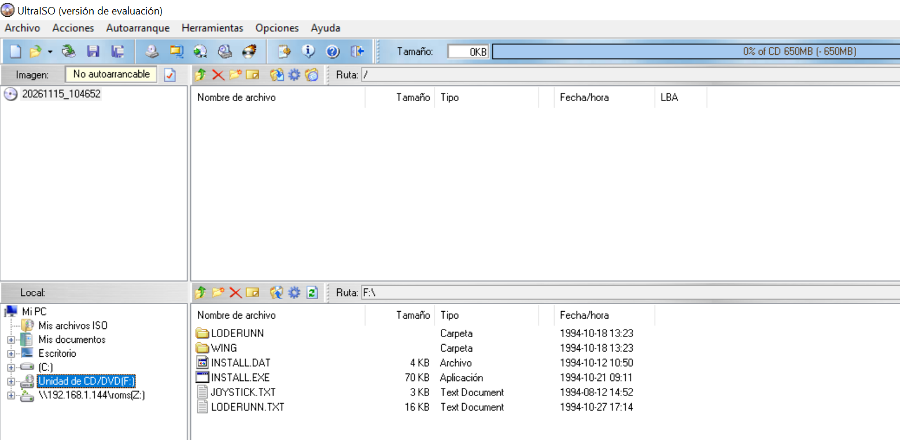

[Captura original para el registro interno](https://chatgpt.com/library?file_id=libfile_a0779dbf28988191902a8ff14ca52609&account_id=personal). Para la guía pública, utilizar un recorte del listado de `F:` que omita las unidades y rutas ajenas a la prueba.

## 8. Primera prueba de instalación

El primer comando combinado falló al analizar `&`; al separar las instrucciones, `Set-Location` devolvió `DriveNotFoundException` para F:. No se ha ejecutado el instalador. La consulta `Get-CimInstance Win32_LogicalDisk -Filter 'DriveType = 5'` no devolvió resultados en la sesión mostrada. Tras cerrar UltraISO, la comprobación se repitió con resultado positivo en `F:`. La prueba posterior con otvdm 0.9.0 portable desde la raíz de `F:` abrió el asistente gráfico de Presage. El cuadro permite elegir el directorio de instalación y muestra `C:\` como valor inicial. Queda pendiente continuar el asistente y comprobar el resultado de la instalación.

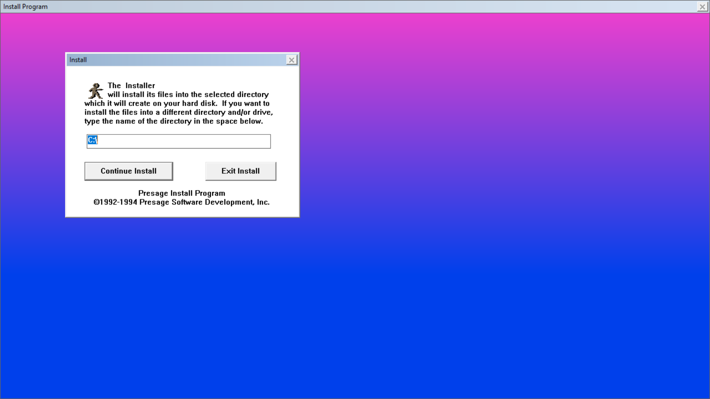

[Captura original](https://chatgpt.com/library?file_id=libfile_08382ec0485881918fcda7f45e388253&account_id=personal)

## 9. Opciones de instalación

El asistente llegó a `Lode Runner CD Install Options`. La pantalla muestra el destino `C:\Users\Miguel\git\ISOs\test\INSTALACION`, la modalidad `Full` seleccionada y `Install Joystick Drivers` desmarcado. Indica 16.521.884 bytes requeridos para Lode Runner y 307.694 bytes para WinG. La captura acredita la configuración visible antes de pulsar `Install Me!`. La copia de archivos y la instalación de WinG quedan pendientes de comprobar.

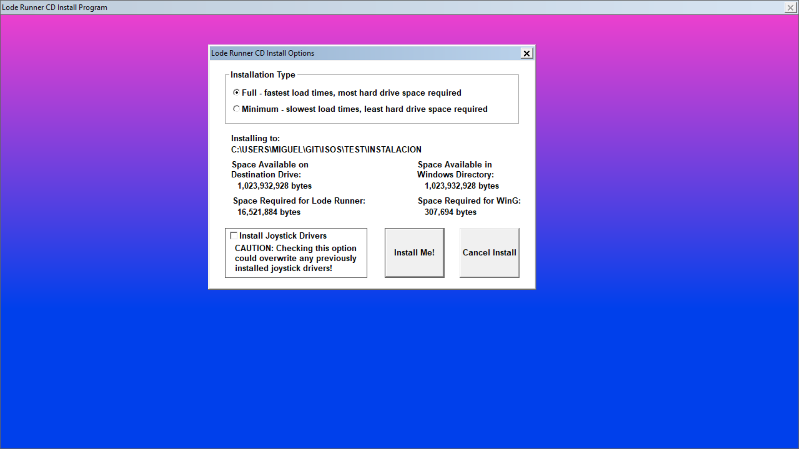

[Captura original](https://chatgpt.com/library?file_id=libfile_c8649a52e550819197125113c77f05e4&account_id=personal)

## 10. Resultado de la instalación

El responsable confirma que el asistente terminó. La carpeta `C:\Users\Miguel\git\ISOs\test\INSTALACION` contiene `LODERUNN.EXE`, `BALLOONH.DLL`, `INSTLLR.EXE`, los textos y las carpetas `data`, `joystick`, `puzzles` y `savegame`. La captura acredita la presencia de estos archivos y carpetas. La instalación efectiva de los componentes WinG y la reproducción de CD-DA quedan pendientes de comprobar.

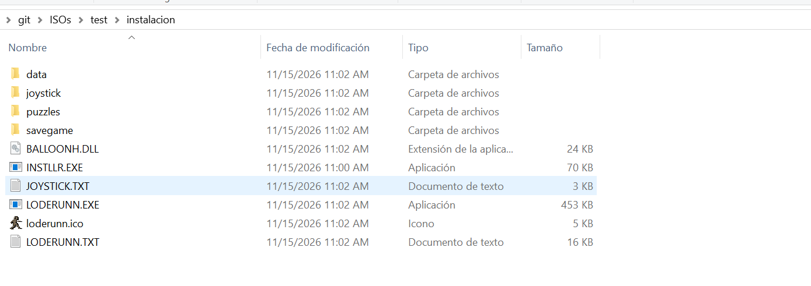

[Captura original](https://chatgpt.com/library?file_id=libfile_8b81f81aea588191914bd5386c136b5a&account_id=personal)

## 11. Primera prueba de arranque

Al lanzar `LODERUNN.EXE` con otvdm 0.9.0 portable apareció `Lode Runner Error` antes de llegar al menú. El diálogo pide comprobar la presencia del CD, si otra aplicación utiliza la unidad y el controlador Windows MCI CD Audio. El aviso no identifica por sí solo la causa. El acceso a los archivos de `F:` ya se había confirmado. Se consultó MCI de Windows con el juego cerrado.

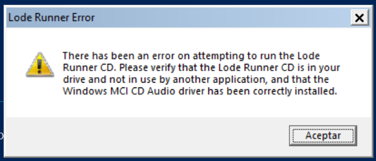

[Captura original](https://chatgpt.com/library?file_id=libfile_b121aaefc7a881919488170e4907046d&account_id=personal)

## 12. Diagnóstico de CD-DA desde Windows

La consulta directa a `winmm.dll` desde PowerShell abrió `F:` con `open F: type cdaudio alias pcgalode wait`. `status pcgalode number of tracks` devolvió **1**. La consulta `status pcgalode type track 2` devolvió **MCI 282**, parámetro fuera del intervalo, y se cerró el dispositivo en el bloque `finally`.

En la configuración probada, Windows accede a los archivos del volumen virtual, pero MCI no ve las 33 pistas que describe el CUE. El resultado se obtuvo fuera de otvdm. El control con el CD original en la unidad física `D:` devolvió **33 pistas** y clasificó la pista 2 como **audio**. Este control confirma que MCI puede enumerar el original y que, en el montaje probado con UltraISO, `F:` solo expuso una pista a MCI. El arranque con el CD físico se confirmó después como prueba de control. La reproducción de música y la jugabilidad no se confirmaron por separado.

El manual `LODERUNN.TXT` documenta `CDdrive=` en `LODERUNN.INI` para cambiar la letra de la unidad del juego. La búsqueda en PowerShell localizó el INI utilizado por la instalación portable en `otvdm-v0.9.0/WINDOWS/loderunn.ini`. La línea 2 contiene `CDdrive=F`. El responsable confirmó que el juego arranca con el CD original tras la prueba propuesta con `CDdrive=D`.

## 13. Objetivo de compatibilidad desde imagen

El arranque con el disco físico queda como control del diagnóstico. El objetivo es ejecutar la edición instalada a partir del BIN/CUE de trabajo, con el CD físico retirado, y comprobar arranque, música CD-DA, efectos y juego en un nivel. Se priorizan las herramientas disponibles. El responsable confirma que UltraISO generó el derivado Nero (`LODE_RUNNER_CD_PRUEBA.nrg`) a partir del CUE de trabajo y que IsoBuster 5.8 muestra las 33 pistas (una de datos y 32 de audio). Resultado comunicado, sin captura adjunta. El responsable confirma que pudo montar el NRG con «CDEmu». El nombre y la versión exactos del montador siguen pendientes de confirmar.

### NRG montado con CDEmu

En la unidad virtual `E:`, `open E: type cdaudio alias pcgalode wait` se completó sin error. `status pcgalode number of tracks` devolvió **MCI 262**, error del dispositivo. La consulta no devolvió un número de pistas y no llegó a consultar el tipo de la pista 2. IsoBuster 5.8 sí enumeró 33 pistas en el archivo NRG. El nombre y la versión exactos de CDEmu siguen pendientes de confirmar.

### NRG montado con UltraISO

La primera consulta se interrumpió por un carácter de control añadido a `Out-Null`. En la repetición válida, MCI abrió `F:` y devolvió **1 pista**. El mismo montador ya había devuelto una pista al montar el CUE. IsoBuster 5.8 enumeró las 33 pistas del NRG. El arranque desde imagen continúa sin validar.

### Siguiente vía de trabajo

Se comprobó el catálogo oficial de [ScummVM 2026.4.0](https://www.scummvm.org/compatibility/2026.4.0/) y el de [desarrollo](https://www.scummvm.org/compatibility/). Lode Runner: The Legend Returns de Presage no figura como compatible. No se realizó una prueba de ejecución con ScummVM.

Evaluar Windows 3.1 o Windows para Trabajo en Grupo 3.11 en DOSBox Staging 0.83.0, con la copia BIN/CUE original montada como CD dentro del emulador. El manual de DOSBox Staging documenta Windows 3.1 y CD-DA desde BIN/CUE. Queda pendiente confirmar si el laboratorio dispone del entorno invitado o de sus medios de instalación, y validar el acceso y la reproducción de CD-DA dentro del invitado. DAEMON Tools queda como alternativa pendiente si no se puede seguir por esa vía.

La búsqueda local no encontró `WIN.COM` en las carpetas de herramientas e imágenes. En las rutas revisadas (herramientas, imágenes, Descargas y Escritorio), la búsqueda por nombres de Windows 3.x solo devolvió `windows-31.html`, el manual incluido con DOSBox Staging 0.83.0. El entorno invitado y sus medios siguen sin localizarse. Se retoma la prueba de montaje directo con DAEMON Tools Lite como candidato: montar el BIN/CUE de trabajo y comprobar el recuento de pistas mediante MCI antes de modificar `CDdrive`.

## 14. Inspección del BIN/CUE en DOSBox Staging

El responsable indica que no dispone de los medios de Windows 3.x. También comunica que el juego indica «DOS 5.0 o superior», lo que motivó la comprobación de una vía de ejecución directa en DOS.

La captura muestra el volumen `LODERUNNER` montado en `D:` dentro de DOSBox Staging, con acceso a la raíz y a `D:\LODERUNN\FILES`. En este último directorio figuran `LODERUNN.EXE` (463.360 bytes), `BALLOONH.DLL`, `COMMDLG.DLL` y `DIB.DRV`. El listado confirma acceso a los datos desde la imagen. La reproducción de CD-DA en DOSBox sigue pendiente.

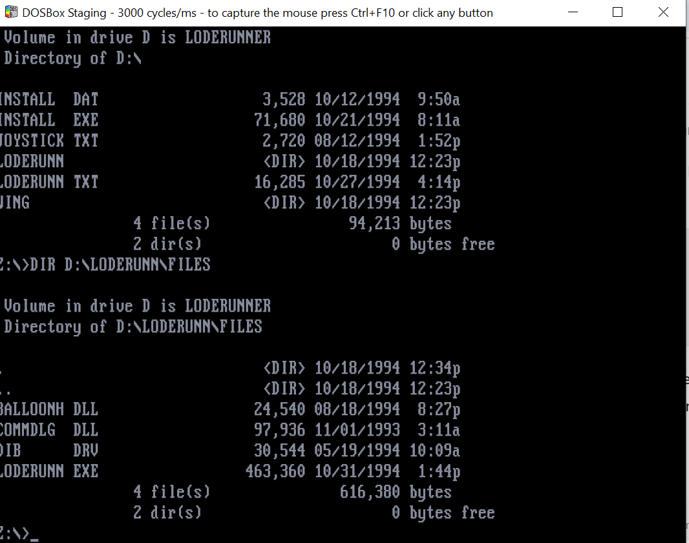

[Captura original](https://chatgpt.com/library?file_id=libfile_4049948c61e881918a64f8fe8326e19a&account_id=personal)

### Arranque directo desde DOS

Desde `Z:\>` se ejecutó `D:\LODERUNN\FILES\LODERUNN.EXE`. La consola mostró `This program must be run under Microsoft Windows.` y volvió a `Z:\>`. El ejecutable principal de esta ruta requiere Windows. El inventario recursivo de la pista ISO 9660 extraída mediante IsoBuster, filtrado por `.EXE`, `.COM` y `.BAT`, devolvió únicamente `INSTALL.EXE` y `LODERUNN/FILES/LODERUNN.EXE`. Ambos requieren Windows. No se identificó un lanzador DOS autónomo en la pista de datos de esta edición. La mención a DOS 5.0 en la edición no acredita por sí sola un segundo ejecutable.

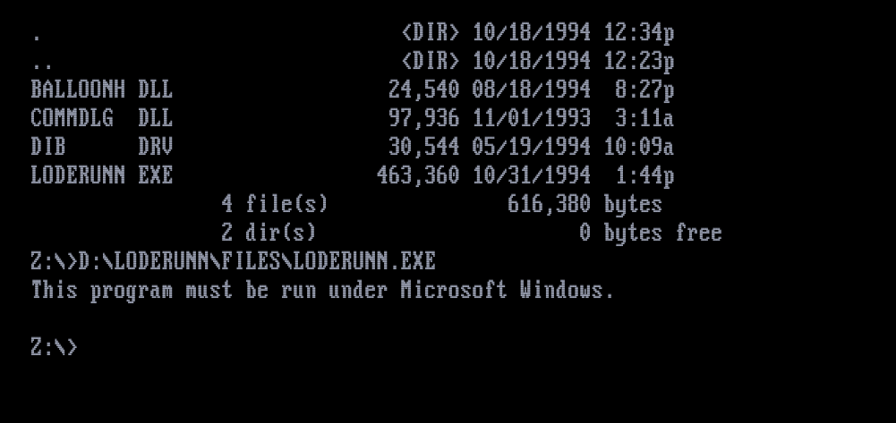

[Captura original](https://chatgpt.com/library?file_id=libfile_f8c82000207481918dbd4bfeb5390d09&account_id=personal)

### BIN/CUE montado con DAEMON Tools Lite

El responsable montó el BIN/CUE de trabajo en la unidad virtual `E:`. La consulta directa a MCI abrió `E:` y devolvió **33 pistas**. MCI identificó la pista 2 como **audio**. Este resultado coincide con el control realizado con el CD original en `D:`. Versión comunicada por el responsable: DAEMON Tools Lite 12.6. Número de compilación detallado no comunicado.

### Primer intento de arranque con el montaje en E:

La captura aportada tras la instrucción de cambiar `CDdrive` a `E` y arrancar con otvdm vuelve a mostrar `Lode Runner Error` sobre el CD y Windows MCI CD Audio. La consulta posterior al INI de otvdm confirmó `CDdrive=E`. Con el juego cerrado, el responsable confirma que oyó música al solicitar por MCI el tramo inicial de la pista 2 de `E:`. Queda validada la reproducción audible de CD-DA desde el BIN/CUE por MCI en el anfitrión. El arranque y la reproducción desde el juego siguen pendientes. Se recogió la traza del arranque con otvdm 0.9.0 y el mismo montaje.

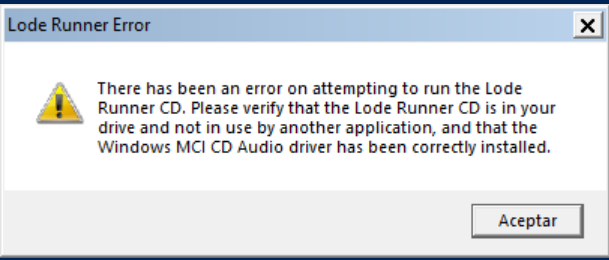

[Captura original](https://chatgpt.com/library?file_id=libfile_9c88d8d1c2d88191a6e61c646b8b0fba&account_id=personal)

### Traza del arranque con otvdm

La traza Win16 registra `sysinfo cdaudio quantity` (retorno 0), `open cdaudio alias LR1A` (retorno 0) y `status LR1A number of tracks` (retorno `0x106`, 262, `MCIERR_HARDWARE`). A continuación el juego cierra `LR1A` y muestra el aviso. La apertura no especifica letra de unidad. La traza no identifica qué unidad se abrió en esa llamada. La consulta exitosa anterior seleccionó explícitamente `E:`. La comparación en la misma sesión de PowerShell reprodujo `MCI 262` al contar las pistas tras `open cdaudio alias pcgalode`. La apertura explícita de `E:` devolvió **33 pistas**. El fallo de la apertura sin letra se reproduce fuera de otvdm. La identidad de la unidad seleccionada sigue sin confirmar. El inventario `Win32_CDROMDrive` mostró dos unidades `DiscSoft Virtual SCSI CdRom Device`: `D:` vacía (`MediaLoaded=False`) y `E:` con el medio (`MediaLoaded=True`). En ese inventario no apareció ningún lector físico. La identidad de la unidad abierta sin letra sigue siendo una hipótesis. Se realizó un control trasladando el montaje a `D:`.

[Traza original](https://chatgpt.com/library?file_id=libfile_4ca011d488888191b28ded0c4c8f26f4&account_id=personal)

### BIN/CUE montado en la unidad virtual D:

El responsable confirmó que el mismo BIN/CUE quedó montado en `D:` con DAEMON Tools Lite. Con el juego cerrado, la apertura MCI sin letra (`open cdaudio alias pcgalode`) devolvió **33 pistas** y clasificó la pista 2 como **audio**. Se utilizó la misma forma de apertura que hace Lode Runner en su comprobación inicial. El fallo 262 de esa consulta dejó de reproducirse en esta configuración. Tras la indicación de ajustar `CDdrive=D` en el INI de otvdm y ejecutar `LODERUNN.EXE` con el CD físico retirado, el responsable confirmó que el juego arranca correctamente. Este resultado de arranque desde el BIN/CUE se documenta por confirmación del responsable. 

### Prueba funcional desde la imagen

El responsable confirmó que jugó el primer nivel con la imagen montada y que funcionaron el teclado, la música de fondo y los efectos. La comprobación se registra por confirmación del responsable. En una prueba posterior con la misma configuración, el responsable confirmó que guardó una partida, cerró el juego, lo volvió a abrir y cargó la partida correctamente. Guardado, cierre, segundo arranque y carga quedan verificados por confirmación del responsable. El entorno anfitrión de referencia para esta prueba es PCGA-LAB-01, documentado con Windows 10 Pro 22H2 x64, compilación 19045.6466. El dato procede de la ficha pública de PCGA-LAB-01 del proyecto.

### Confirmación del entorno anfitrión

La captura de `winver` confirma Windows 10 Pro 22H2, compilación `19045.6466`, en concordancia con la ficha de PCGA-LAB-01. La arquitectura x64 consta en la ficha del laboratorio.

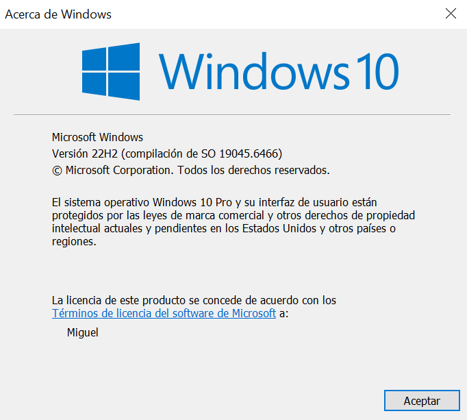

[Captura original de winver para el registro interno](https://chatgpt.com/library?file_id=libfile_f21dc3b3510081918471c4e93949d8f4&account_id=personal)

## Repetición con DAEMON Tools desde la instalación

El instalador original se abrió desde `D:\INSTALL.EXE` con otvdm 0.9.0. La imagen BIN/CUE estaba montada en la unidad virtual `D:` de DAEMON Tools Lite 12.6. El asistente mostró la carpeta de destino `lode-runner`, el origen `D:\` y la opción `Full`, con los controladores de joystick desmarcados. El responsable confirmó que la instalación terminó. Las tres capturas de esta secuencia tienen copias anonimizadas para la guía pública.

El responsable confirmó que el juego funciona al arrancarlo con otvdm desde la nueva carpeta `lode-runner`, manteniendo el BIN/CUE en `D:`. Para esta repetición se indicó conservar el INI tal como lo dejó el instalador. Se utilizó la copia de otvdm ya disponible en el laboratorio. Las comprobaciones específicas de audio y guardado constan en la prueba funcional anterior.
